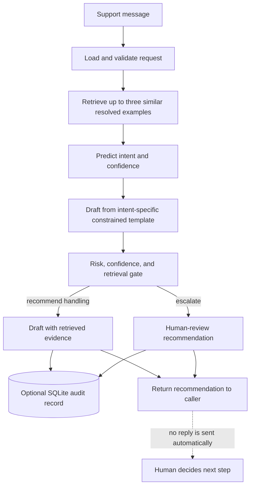

<p align="center">
  
</p>

<h1 align="center">Relay</h1>

Relay is an auditable Python prototype for handling AmazonHelp-style customer support messages. For each message, it retrieves similar historical cases, predicts an intent, drafts a constrained reply, and recommends whether to auto-handle or escalate. The result includes the retrieved examples and a reason for the decision.

Relay only recommends a response. It does not send messages, access customer accounts, make account changes, or promise refunds.

## Quick start

Requirements: Python 3.10 or later. The core prototype uses only the Python standard library.

From the repository root, run:

```powershell
$env:PYTHONPATH = "src"
python -m relay_agent.cli bootstrap-demo
python -m relay_agent.cli run --text "My package is late and tracking stopped yesterday"
python -m relay_agent.cli evaluate
```

`bootstrap-demo` creates synthetic example and evaluation CSVs. `run` prints a JSON result. `evaluate` prints metrics and writes `artifacts/evaluation.json`; each handled message is also recorded in `data/audit.sqlite3`.

All commands accept `--root PATH` when you want the input data and generated artifacts to live under a different project directory. By default, Relay uses the repository root.

To run the test suite:

```powershell
$env:PYTHONPATH = "src"
python -m unittest discover -s tests -v
```

## How it works

Relay processes a support message through retrieval, intent prediction, constrained drafting, and a conservative escalation check. It returns the evidence and reason so a human can decide what to do.



“Auto handle” is only a recommendation: Relay never sends the reply or changes a customer account. The included CSV examples are synthetic fixtures and are not a real-world evaluation set.

1. **Retrieve:** a small TF-IDF retriever finds up to three similar resolved examples.
2. **Classify:** keyword scores and retrieved intent labels produce an intent and confidence estimate.
3. **Draft:** an intent-specific template creates a reply grounded by the retrieved examples.
4. **Decide:** a conservative gate escalates high-risk language, refund and account cases, low-confidence predictions, and weak retrieval matches.
5. **Audit:** the input, prediction, response, decision, reason, and retrieved evidence are stored in SQLite when auditing is enabled.

The `auto_handle` result is a recommendation for a downstream human-reviewed workflow. This prototype never sends the drafted reply.

## Repository guide

| Path | Purpose |
| --- | --- |
| `src/relay_agent/` | Application package: CLI, pipeline, retrieval, classification, response drafting, escalation, evaluation, data loading, and audit logging. |
| `src/relay_agent/cli.py` | `bootstrap-demo`, `run`, and `evaluate` commands. |
| `src/relay_agent/pipeline.py` | Connects retrieval, classification, drafting, decision, and audit steps. |
| `src/relay_agent/retrieval.py`, `classifier.py`, `responder.py`, `gate.py` | Core message-processing stages. |
| `src/relay_agent/models.py`, `data.py`, `audit.py` | Data structures, CSV readers/writers, and SQLite audit storage. |
| `src/relay_agent/demo.py`, `evaluate.py`, `llm_judge.py` | Synthetic fixture generation, offline metrics, and optional external judging. |
| `tests/` | Automated checks for escalation and pipeline output. |
| `data/demo/` | Small synthetic historical-resolution examples used by the demo. |
| `data/golden/` | Synthetic evaluation examples; labels are not human verified. |
| `data/README.md` | Fixture schemas, counts, and guidance for replacing the generated data. |

## Data and evaluation

The checked-in CSVs are generated demo fixtures, not a real or human-reviewed benchmark. Their evaluation scores must not be presented as real-world performance. Before a formal evaluation, replace them with a documented, permitted dataset sample, independently review the golden labels and replies, and prevent conversation-level leakage between retrieval and evaluation data. `data/README.md` documents the fixture schemas and replacement considerations.

The default reply-quality score is a transparent offline proxy, not an LLM judge or human rating. To optionally score evaluation replies with the OpenAI API, set `OPENAI_API_KEY` and run:

```powershell
$env:OPENAI_API_KEY = "your-key"
python -m relay_agent.cli evaluate --judge openai
```

This makes external API requests and may incur usage charges. Compare the judge against independent human ratings before reporting judge agreement. The optional judge requires no extra package, but does require network access and a valid API key.

## Project details

- Distribution name: `relay-support-agent`
- Import and command package: `relay_agent`
- Python requirement: `>=3.10`
- Optional environment variable: `OPENAI_API_KEY` for `--judge openai`

